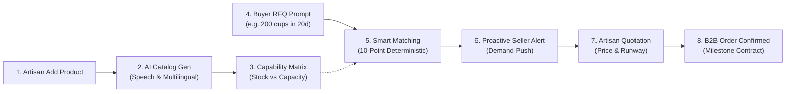

# 🏺 CraftConnect: AI-Powered B2B Artisan Capability Linkage Platform

> **"We don't just digitize the artisan — we connect what they can produce with what businesses actually need."**

[]()
[]()
[]()

---

## 🌟 The Core Innovation

Traditional e-commerce platforms merely catalog what an artisan has already made and placed on a shelf (*"In Stock: 50"*). When institutional buyers (cafes, boutique hotels, corporate gifting) need bulk orders of 200–500 units, standard marketplaces fail:
1. They display **"Out of Stock"**.
2. Artisans have no vehicle to signal **scalable workshop capacity**.
3. Demands sit passively on message boards without deterministic constraint validation.

**CraftConnect solves this by modeling capability-aware market linkage:**
- **Available Now vs Monthly Production Capacity**: Separates immediate dispatch inventory from workshop manufacturing velocity (e.g. 50 in stock + 150 produced over 12 days = 200-unit bulk order fulfilled comfortably).
- **Deterministic 10-Point Matching Engine**: Hard business rules (MOQ feasibility, production runway vs deadline, price ceiling, and custom branding capability) ensure zero AI hallucination on business constraints.
- **Demand Reaches the Artisan**: When a buyer posts a natural-language requirement, qualified leads proactively alert the artisan's dashboard with pre-calculated fulfillment paths.

---

## 🚀 The End-to-End Workflow



1. **Artisan Digital Onboarding**: Artisan inputs basic details or speaks voice note in Hindi/English.
2. **AI Catalog Generation**: Generates B2B product pitch, technical specs, material classifications, and asks multilingual follow-up questions for missing details.
3. **Capability Profile**: Distinguishes *Available Now* from *Monthly Production Capacity*, MOQ, and Lead Time.
4. **Buyer Requirement Understanding**: Natural language parser extracts structured specifications (product, quantity, budget, deadline, customization).
5. **Smart Matching Engine**: Ranks artisans with explainable reasoning checklists and match scores.
6. **Proactive Demand Push**: Artisans receive direct alerts on their dashboard for matching opportunities.
7. **Artisan Response & Quotation**: Artisan selects *"I Can Fulfil"* and submits an official commercial quotation.
8. **Buyer Acceptance & Work Order**: Buyer accepts quotation, confirming the business opportunity with production milestones.

---

## 🛠️ Tech Stack

- **Frontend**: React 18, Vite 6, Tailwind CSS, Lucide Icons
- **Backend**: Node.js (ES Modules), Express.js
- **Database**: Local JSON persistence engine with instant demo reset capability
- **AI Engine**: Google Gemini API (`@google/generative-ai`) with **built-in intelligent heuristic fallback** (guarantees the prototype never breaks if an API key is missing or rate-limited)

---

## ⚡ Quickstart & Setup

### Prerequisites
- Node.js (v18 or higher)
- npm (v9 or higher)

### 1. Installation
Install all dependencies (root, backend, and frontend) in one step:
```bash
npm run install:all
```
*(or simply `npm install`)*

### 2. Environment Variables (Optional)
The platform includes an intelligent heuristic fallback AI engine that runs 100% locally out of the box without any keys.

To enable live Google Gemini Flash:
1. Copy `.env.example` to `backend/.env`:
   ```bash
   cp .env.example backend/.env
   ```
2. Add your Gemini API key:
   ```env
   GEMINI_API_KEY=your_gemini_api_key_here
   PORT=5001
   ```

### 3. Start Development Servers
Run both backend (port 5001) and frontend (port 5173) concurrently:
```bash
npm run dev
```

Open your browser at:
👉 **http://localhost:5173**

---

## 🎯 2-Minute Judge Demo Flow

CraftConnect includes an interactive **Demo Tour Bar** at the top of the screen with 1-click step buttons and an instant **Reset** button:

1. **Step 1: Artisan Dashboard**
   - View *Meera Handicrafts* (Jaipur, Rajasthan • Terracotta & Handmade Pottery).
   - Observe the 4 core metrics: Products (3), Current Opportunities (2), Active Quotations (1), Monthly Capacity (500 units).
2. **Step 2: Add Product & AI Catalog Generation**
   - Click *+ Add Product*.
   - Click the *⚡ 1-Click Demo Fill* button (*Handmade Terracotta Cup*).
   - Test speech simulation or click **Generate AI Catalog & B2B Specs**.
   - Notice the multilingual AI follow-up question: *"क्या आप इस उत्पाद में कस्टम लोगो प्रिंटिंग या ब्रांडिंग प्रदान कर सकते हैं?"*
   - Click an answer pill and see the catalog dynamically update.
   - Click **Confirm & Publish to Capability Profile**.
3. **Step 3: Capability Matrix**
   - Switch to the *Artisan Capability Profile* tab.
   - Observe how **Available Now (50 units)** is clearly distinguished from **Monthly Capacity (300 units)**.
4. **Step 4: Buyer Requirement**
   - Click *Buyer Portal* or Tour Step 4.
   - Profile: *Rajasthan Cafe Group* (Hospitality Procurement).
   - Natural language prompt: *"I need 200 customized terracotta cups under ₹150 each within 20 days."*
   - Click **Understand Requirement (AI)** to view structured extraction.
5. **Step 5: Smart Matching Engine**
   - Click **Post Requirement & Find Matching Artisans**.
   - View explainable fit cards:
     - **Meera Handicrafts (94% Match - ELIGIBLE)**: ✓ Produces terracotta cups, ✓ Can fulfill 200 units (50 in stock + 150 made in 13 days), ✓ Within ₹150 budget (saves ₹30/unit), ✓ Supports logo stamping, ✓ Local cluster advantage (Jaipur).
     - **Rajasthan Craft Studio (91% Match - ELIGIBLE)**: Fast regional dispatch.
     - **Mitti Kala Works (40% Match - NOT ELIGIBLE)**: Violates 20-day timeline (needs 29 days) and exceeds budget.
   - Click **Request Quotation** to push the lead to the artisan.
6. **Step 6: Proactive Notification & Quotation**
   - Return to the Artisan view.
   - Notice the glowing notification for the new business opportunity.
   - Click **View Opportunity & Submit Quotation**.
   - Select **I Can Fulfil**, enter ₹120/unit, 15 days delivery, and submit.
7. **Step 7: Order Confirmation**
   - In the Buyer Portal, open the received quotation.
   - Click **Accept Quotation & Confirm Deal**.
   - Review the confirmed B2B Work Order with structured production milestones!

---

## 🏛️ Architecture Overview

```
CraftConnect/
├── backend/
│   ├── data/
│   │   └── db.json               # Seed database (artisans, buyers, products, RFQs)
│   ├── aiService.js              # Gemini Flash + Intelligent Heuristic Fallback
│   ├── matchingEngine.js         # Deterministic 10-point capability matcher
│   ├── db.js                     # Local JSON persistence & instant demo reset
│   └── server.js                 # Express REST API & static asset serving
├── frontend/
│   ├── src/
│   │   ├── components/
│   │   │   ├── DemoTourBar.jsx          # Interactive 2-minute judge tour guide
│   │   │   ├── Navbar.jsx               # Navigation, role switcher, notification pulse
│   │   │   ├── LandingPage.jsx          # Value proposition & workflow visualization
│   │   │   ├── ArtisanDashboard.jsx     # Metrics, opportunities, capability matrix
│   │   │   ├── AddProductModal.jsx      # Speech-to-catalog & multilingual AI assistant
│   │   │   ├── BuyerDashboard.jsx       # RFQs, quotations received, confirmed contracts
│   │   │   ├── CreateRequirementModal.jsx # Natural language AI parser
│   │   │   ├── MatchResultsModal.jsx    # 10-point explainable fit analysis
│   │   │   ├── ArtisanQuotationModal.jsx# Opportunity fulfillment & bid submission
│   │   │   └── QuotationReviewModal.jsx # B2B contract confirmation & milestones
│   │   ├── api.js                       # Frontend API client
│   │   ├── App.jsx                      # Master layout & state synchronization
│   │   ├── main.jsx                     # React root
│   │   └── index.css                    # Tailwind CSS configuration
│   ├── package.json
│   ├── tailwind.config.js
│   └── vite.config.js
├── package.json                         # Root orchestration scripts
└── README.md
```

---

## 🛡️ Reliability & Hackathon Resilience

- **Zero-Failure Guarantee**: If Gemini API credentials are absent or rate-limited, the system falls back to its deterministic heuristic engine without crashing or displaying error screens.
- **Instant Demo Reset**: Click the **Reset** button in the Demo Tour Bar at any point during presentation to restore pristine initial state in under 500ms.
- **Fully Local**: Works completely offline without external databases.

